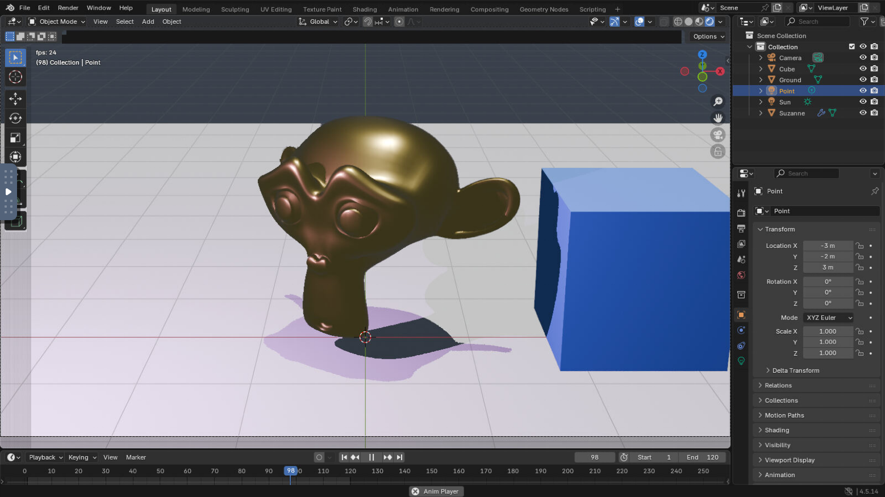

# Blender in the browser, from a Modal Sandbox

Blender's full GUI runs in a [Modal Sandbox](https://modal.com/docs/guide/sandboxes) on
a GPU. You watch and control it from a browser tab, and a script edits the scene live
over HTTP while you watch. The same two channels serve an AI agent: it sees the viewport
and changes the scene with `bpy` code, and a person looks over its shoulder.



```bash
pip install modal
modal setup
modal run blender_vnc.py
```

The command prints two URLs. Open the first: Blender comes up with a scene, the script
adds a cube, turns the monkey gold, adds a light and starts an animation. Then it is
your turn for ten minutes (`--minutes 30` for longer). Ctrl-C ends the Sandbox.

The first run builds the image (Blender 4.5, TurboVNC, VirtualGL), which takes a few
minutes. After that, Blender is ready about 20 s after the command starts.

## How it works

| Piece                                | Role                                                                                                                    |
| ------------------------------------ | ----------------------------------------------------------------------------------------------------------------------- |
| [`blender_vnc.py`](blender_vnc.py)   | Builds the image, starts the Sandbox, prints the URL, sends the demo edits, waits for you                               |
| [`blender_live.py`](blender_live.py) | Runs inside Blender. Builds the starter scene, then runs any `bpy` snippet POSTed to port 8000 on Blender's main thread |

Inside the Sandbox:

- [TurboVNC](https://turbovnc.org)'s `Xvnc` is the X server and the VNC server.
  [noVNC](https://novnc.com) serves it to the browser over a websocket.
- [VirtualGL](https://virtualgl.org) (`vglrun -d egl`) sends Blender's OpenGL to the GPU
  through EGL and copies each frame into the X server. Without it Blender draws with
  Mesa's software renderer. The script prints the renderer Blender sees, for example
  `NVIDIA L4/PCIe/SSE2`.
- Both ports are exposed with `encrypted_ports`, so each gets an HTTPS tunnel URL. The
  URLs are the only access control: anyone with them can drive Blender.

Edit the scene yourself from another terminal, with the second URL the script prints:

```bash
curl -X POST "$BLENDER_URL" --data-binary 'bpy.data.objects["Suzanne"].scale = (2, 2, 2)'
```

## Options

| Flag        | Default | Notes                                                                                |
| ----------- | ------- | ------------------------------------------------------------------------------------ |
| `--gpu`     | `L4`    | Any Modal GPU type                                                                   |
| `--region`  | none    | Pin near you (`eu-west`, `us-east`, ...). VNC frame rate is bound by round trip time |
| `--minutes` | `10`    | How long the Sandbox stays up after the demo edits                                   |
